# NBA Hub Database ERD

This ERD summarizes the Supabase tables defined by `SUPABASE_COMPLETE_SETUP.sql` and the project migrations. `AUTH_USERS` represents Supabase's managed `auth.users` table.

```mermaid
erDiagram
    AUTH_USERS {
        uuid id PK
    }

    APP_PROFILES {
        uuid user_id PK
        text app_id PK
        text role
        text username
        text display_name
        text avatar_url
        text email
        jsonb settings
        timestamptz created_at
        timestamptz updated_at
    }

    COMMUNITY_CHALLENGES {
        uuid id PK
        uuid owner_id FK    
        text title
        text description
        text creator
        text rule_type
        jsonb selected_player_ids
        timestamptz created_at
    }

    OFFICIAL_CHALLENGES {
        uuid id PK
        uuid created_by FK
        text title
        text description
        text rule_type
        text difficulty
        text icon
        jsonb player_tiers
        timestamptz created_at
    }

    TRADE_MACHINE_TRADES {
        uuid id PK
        uuid owner_id FK
        text client_id
        text creator_username
        jsonb payload
        boolean is_featured
        boolean is_pinned
        boolean is_verified
        text moderation_status
        boolean comments_locked
        timestamptz moderated_at
        uuid moderated_by FK
        timestamptz created_at
    }

    TRADE_MACHINE_COMMENTS {
        uuid id PK
        uuid trade_id FK
        uuid owner_id FK
        text creator_username
        text comment
        timestamptz created_at
    }

    TRADE_MACHINE_RATINGS {
        uuid trade_id PK
        uuid owner_id PK
        smallint rating
        timestamptz created_at
        timestamptz updated_at
    }

    ADMIN_AUDIT_LOG {
        uuid id PK
        uuid actor_id FK
        text app_id
        text action
        text entity_type
        text entity_id
        jsonb before_payload
        jsonb after_payload
        timestamptz created_at
    }

    TRADE_RUMOR_WATCH {
        uuid id PK
        text player_name UK
        text team_name
        text team_abbreviation
        integer rank
        boolean is_active
        timestamptz updated_at
    }

    API_CACHE {
        uuid id PK
        text resource_type
        text cache_key
        jsonb payload
        timestamptz expires_at
        timestamptz created_at
        timestamptz updated_at
    }

    NBA_TEAMS {
        integer id PK
        text name
        text abbreviation
        text conference
        text division
        text city
        boolean is_active
        jsonb metadata
        timestamptz created_at
        timestamptz updated_at
    }

    NBA_PLAYERS {
        text id PK
        integer team_id FK
        text name
        text full_name
        text position
        text jersey_number
        boolean is_active
        jsonb metadata
        timestamptz created_at
        timestamptz updated_at
    }

    NBA_GAMES {
        text id PK
        text season
        timestamptz game_date
        integer home_team_id FK
        integer away_team_id FK
        text status
        integer home_score
        integer away_score
        jsonb metadata
        timestamptz created_at
        timestamptz updated_at
    }

    NBA_BOX_SCORES {
        text game_id PK
        text player_id PK
        integer team_id FK
        text season
        jsonb payload
        timestamptz created_at
        timestamptz updated_at
    }

    NBA_STANDINGS {
        text season PK
        text season_type PK
        integer team_id PK
        jsonb payload
        timestamptz created_at
        timestamptz updated_at
    }

    NBA_DRAFT_PICKS {
        integer team_id PK
        integer pick_order PK
        smallint year
        smallint round
        text original_owner
        boolean is_swap
        text protection
        text details
        timestamptz created_at
    }

    NBA_PLAYER_CONTRACT_YEARS_SNAPSHOT {
        text player_id PK
        text player_name
        integer contract_years_remaining
    }

    AUTH_USERS ||--o{ APP_PROFILES : has
    AUTH_USERS o|--o{ COMMUNITY_CHALLENGES : owns
    AUTH_USERS o|--o{ OFFICIAL_CHALLENGES : creates
    AUTH_USERS ||--o{ TRADE_MACHINE_TRADES : owns
    AUTH_USERS o|--o{ TRADE_MACHINE_TRADES : moderates
    AUTH_USERS ||--o{ TRADE_MACHINE_COMMENTS : posts
    AUTH_USERS ||--o{ TRADE_MACHINE_RATINGS : rates
    AUTH_USERS o|--o{ ADMIN_AUDIT_LOG : acts
    TRADE_MACHINE_TRADES ||--o{ TRADE_MACHINE_COMMENTS : has
    TRADE_MACHINE_TRADES ||--o{ TRADE_MACHINE_RATINGS : receives
    NBA_TEAMS o|--o{ NBA_PLAYERS : rosters
    NBA_TEAMS o|--o{ NBA_GAMES : home_team
    NBA_TEAMS o|--o{ NBA_GAMES : away_team
    NBA_GAMES ||--o{ NBA_BOX_SCORES : includes
    NBA_PLAYERS ||--o{ NBA_BOX_SCORES : records
    NBA_TEAMS o|--o{ NBA_BOX_SCORES : team_context
    NBA_TEAMS ||--o{ NBA_STANDINGS : has
    NBA_TEAMS ||--o{ NBA_DRAFT_PICKS : owns
```

## Schema notes

- `TRADE_MACHINE_TRADES.payload` stores the trade proposal as JSONB rather than normalized player, pick, and team link tables.
- `COMMUNITY_CHALLENGES.selected_player_ids` and `OFFICIAL_CHALLENGES.player_tiers` contain player references in JSONB; PostgreSQL does not enforce foreign keys for them.
- `NBA_PLAYER_CONTRACT_YEARS_SNAPSHOT.player_id` corresponds to player IDs by convention, but the schema does not declare a foreign key to `NBA_PLAYERS`.
- `API_CACHE` and `TRADE_RUMOR_WATCH` are standalone tables without declared foreign keys.
- Supabase `auth.users` is managed outside the project's `public` schema.
